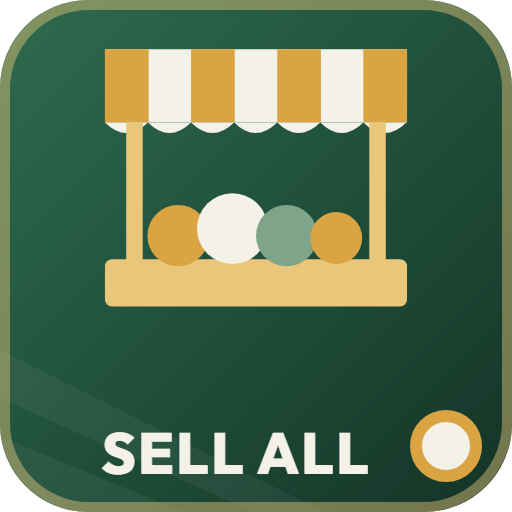

# ModHub upload: Roadside Stand

What to enter in the GIANTS ModHub upload form for this mod. Each text box below has a copy button on GitHub.



**Mod Icon (512x512):** [`icon_512.png`](icon_512.png)

| Field | Value |
|-------|-------|
| Title English | Roadside Stand |
| Title German | Verkaufsstand am Straßenrand |
| Title French | Stand de vente en bord de route |
| Version | `1` `0` `0` `3` |
| Author | DTM Mods, Fennell |
| Manufacturer | Lizard |
| Category 1 | Placeable > Selling Points |
| Category 2 | Not Set |
| Category 3 | Not Set |

## Title English
```text
Roadside Stand
```

## Title German
```text
Verkaufsstand am Straßenrand
```

## Title French
```text
Stand de vente en bord de route
```

## Description English
```text
A roadside selling stand you buy and place on your own farm. Tip crops into its pit or drop bales in its bale zone, and it pays 100% of the base price.

- Accepts field crops, including ones added by your map and other mods.
- Accepts windrows: grass, hay, straw, alfalfa, clover, flax, hemp and legume straw.
- Accepts bales, wood chips and rope pallets.
- Nothing else: no milk, other products, fuel or inputs.
- Pays 100% of the base price. Flooding it with one crop lowers the price, which recovers over 48 in-game hours.
- Price: 100,000. In the construction menu under selling points.

How to use: tip crops, windrows and wood chips into the pit, and drop bales and rope pallets in the bale zone. Both are on the same lane.

Changelog 1.0.0.2:
- New mod icon in the DTM Mods style.
- No other changes.
```

## Description German
```text
Ein Verkaufsstand am Straßenrand, den du kaufst und auf deinem eigenen Hof platzierst. Kipp Feldfrüchte in die Grube oder leg Ballen im Ballenbereich ab, und er zahlt 100 % des Grundpreises.

- Nimmt Feldfrüchte an, auch solche, die deine Karte oder andere Mods hinzufügen.
- Nimmt Schwade an: Gras, Heu, Stroh, Luzerne, Klee, Flachs, Hanf und Leguminosenstroh.
- Nimmt Ballen, Hackschnitzel und Seilpaletten an.
- Sonst nichts: keine Milch, keine anderen Produkte, kein Kraftstoff und keine Betriebsmittel.
- Zahlt 100 % des Grundpreises. Wird zu viel von einer Frucht verkauft, sinkt der Preis und erholt sich über 48 Spielstunden.
- Preis: 100.000. Im Baumenü unter Verkaufsstellen.

So geht's: Feldfrüchte, Schwade und Hackschnitzel in die Grube kippen, Ballen und Seilpaletten im Ballenbereich ablegen. Beides liegt an derselben Spur.

Changelog 1.0.0.2:
- Neues Mod-Icon im Stil von DTM Mods.
- Sonst keine Änderungen.
```

## Description French
```text
Un stand de vente en bord de route que vous achetez et placez sur votre propre ferme. Déversez des récoltes dans sa fosse ou déposez des balles dans sa zone à balles : il paie 100 % du prix de base.

- Accepte les récoltes des champs, y compris celles ajoutées par votre carte et d'autres mods.
- Accepte les andains : herbe, foin, paille, luzerne, trèfle, lin, chanvre et paille de légumineuses.
- Accepte les balles, les plaquettes de bois et les palettes de corde.
- Rien d'autre : ni lait, ni autres produits, ni carburant, ni intrants.
- Paie 100 % du prix de base. Trop vendre d'une même culture fait baisser le prix, qui remonte en 48 heures de jeu.
- Prix : 100 000. Dans le menu de construction, rubrique points de vente.

Utilisation : déversez les récoltes, andains et plaquettes de bois dans la fosse, et déposez les balles et palettes de corde dans la zone à balles. Les deux sont sur la même voie.

Changelog 1.0.0.2 :
- Nouvelle icône du mod dans le style DTM Mods.
- Aucun autre changement.
```

## Before uploading

- The building is the base-game Farmers Market (US) model: its i3d is copied into the mod, its props are loaded from the base game, and the shop image is the base game's own (`$data/.../store_farmersMarketUS.png`). ModHub may treat this as a copy of base-game content; a mod-own shop image is likely needed at least. Owner's decision.
- The store XML brand is `NONE`; the sheet uses `Lizard` as the Manufacturer.
- Missing translations in the mod itself: the shop name and the modDesc title and description are English only. The German/French texts here do not add them to the mod.
