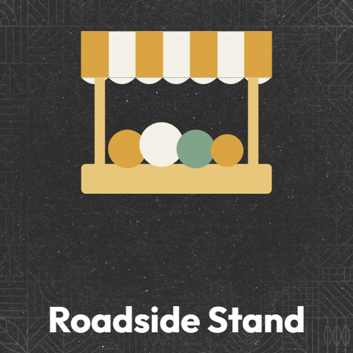

# ModHub upload: Roadside Stand

What to enter in the GIANTS ModHub upload form for this mod. Each text box below has a copy button on GitHub.



**Mod Icon (512x512):** [`icon_512.png`](icon_512.png)

| Field | Value |
|-------|-------|
| Title English | Roadside Stand |
| Title German | Verkaufsstand am Straßenrand |
| Title French | Stand de vente en bord de route |
| Version | `1` `0` `0` `3` |
| Author | DTM Mods, Fennell |
| Manufacturer | Lizard |
| Category 1 | Placeable > Selling Points |
| Category 2 | Not Set |
| Category 3 | Not Set |

## Title English
```text
Roadside Stand
```

## Title German
```text
Verkaufsstand am Straßenrand
```

## Title French
```text
Stand de vente en bord de route
```

## Description English
```text
Category: Selling Points
Price: $100,000
Monthly upkeep: none

A roadside selling stand you can place on your own farm.

It accepts field crops and windrows (grass, hay, straw, alfalfa, clover, flax, hemp, legume straw; including ones added by your map and other mods), bales, wood chips and rope pallets. Nothing else: no milk, other products, fuel or inputs.
Tip crops, windrows and wood chips into the pit and drop bales and rope pallets in the bale zone. Both are on the same lane.

Pays 100% of the base price. Flooding it with one crop lowers the price, which recovers over 48 in-game hours.
```

## Description German
```text
Kategorie: Verkaufsstellen
Preis: 100.000 €
Monatliche Unterhaltskosten: keine

Ein Verkaufsstand am Straßenrand, den du auf deinem eigenen Hof platzieren kannst.

Er nimmt Feldfrüchte und Schwade (Gras, Heu, Stroh, Luzerne, Klee, Flachs, Hanf, Leguminosenstroh; auch solche, die deine Karte und andere Mods hinzufügen), Ballen, Hackschnitzel und Seilpaletten an. Sonst nichts: keine Milch, keine anderen Produkte, kein Kraftstoff und keine Betriebsmittel.
Feldfrüchte, Schwade und Hackschnitzel kippst du in die Grube, Ballen und Seilpaletten legst du in der Ballenzone ab. Beides liegt an derselben Spur.

Zahlt 100 % des Grundpreises. Wird er mit einer Frucht überschwemmt, sinkt der Preis und erholt sich innerhalb von 48 Spielstunden.
```

## Description French
```text
Catégorie : Points de vente
Prix : 100 000 €
Entretien mensuel : aucun

Un stand de vente en bord de route que vous pouvez placer sur votre propre ferme.

Il accepte les récoltes des champs et les andains (herbe, foin, paille, luzerne, trèfle, lin, chanvre, paille de légumineuses ; y compris ceux ajoutés par votre carte et d'autres mods), les balles, les plaquettes de bois et les palettes de corde. Rien d'autre : ni lait, ni autres produits, ni carburant, ni intrants.
Déversez les récoltes, andains et plaquettes de bois dans la fosse, et déposez les balles et palettes de corde dans la zone à balles. Les deux sont sur la même voie.

Il paie 100 % du prix de base. Trop vendre d'une même culture fait baisser le prix, qui remonte en 48 heures de jeu.
```

## Before uploading

- Screenshots for the upload: [`modhub/screenshots/`](screenshots) (1600x900, unedited in-game shots, `1.jpg` first).
- The building is the base-game Farmers Market (US) model: its i3d is copied into the mod, its props are loaded from the base game, and the shop image is the base game's own (`$data/.../store_farmersMarketUS.png`). ModHub may treat this as a copy of base-game content; a mod-own shop image is likely needed at least. Owner's decision.
- The store XML brand is `NONE`; the sheet uses `Lizard` as the Manufacturer.
- Missing translations in the mod itself: the shop name and the modDesc title and description are English only. The German/French texts here do not add them to the mod.
